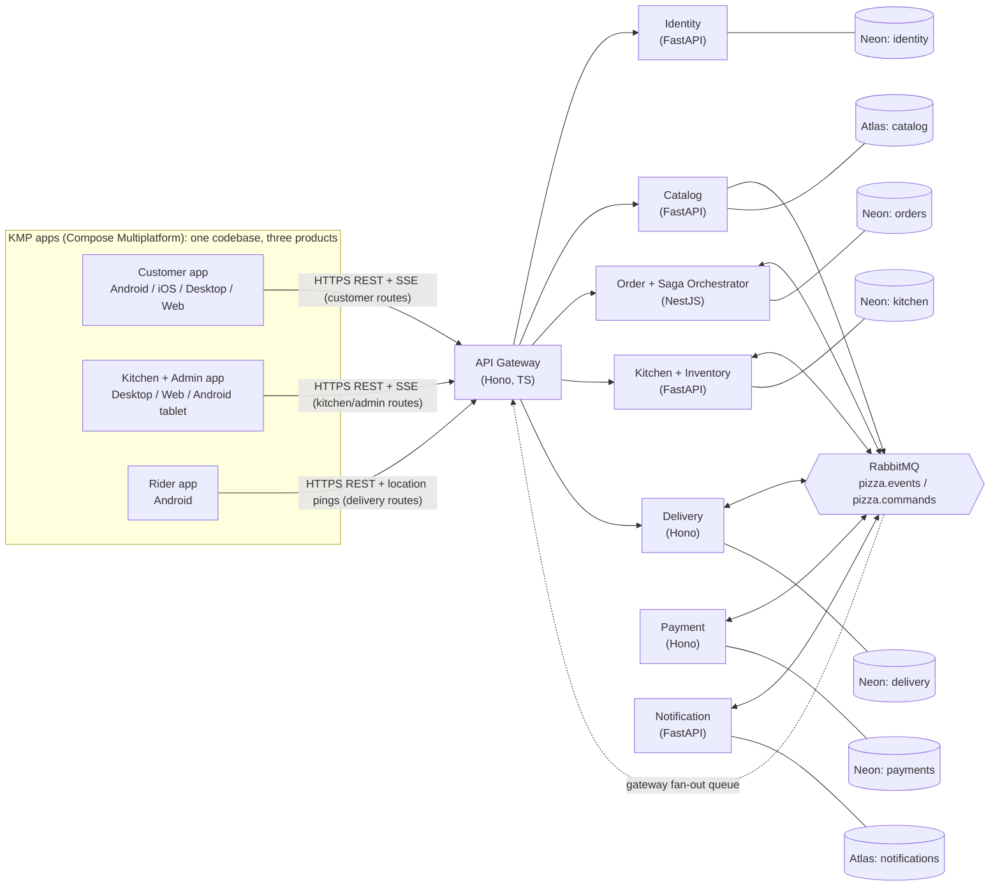
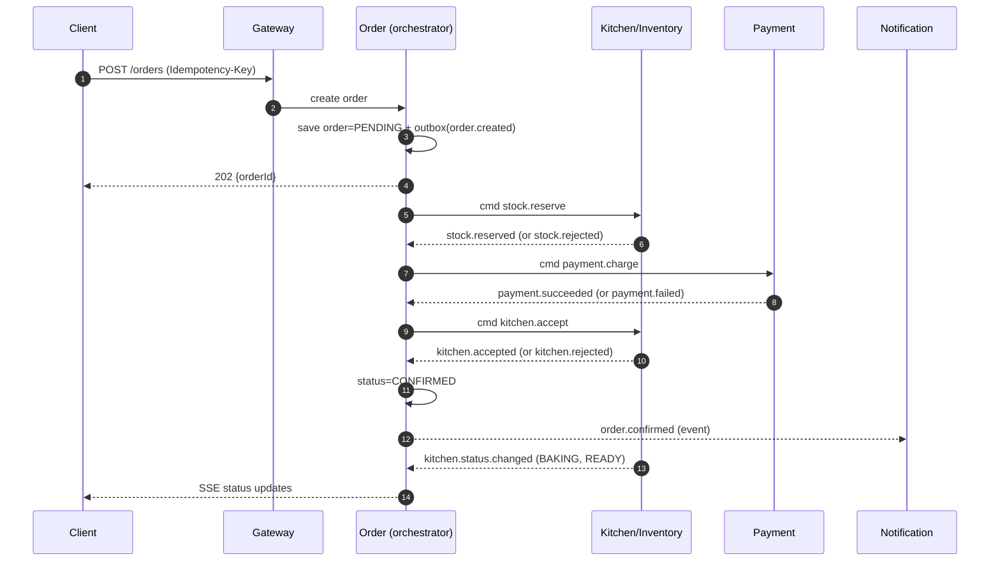

# Pizza Shop — Architecture (v3)

> Designed for: **three Kotlin Multiplatform apps** (Customer, Kitchen/Admin, Rider) from one codebase +
> **polyglot backend** (Node.js/TypeScript + Python/FastAPI) +
> **Neon (Postgres)** + **MongoDB Atlas** + **RabbitMQ**.
> Primary goal: *learn microservice architecture deeply by building something a real pizzeria could run.*

**What changed in v3**
- One client became **three apps** (customer, kitchen/admin, rider) sharing `core/` and `features/` modules (§10).
- New **Delivery service** (#8) and fulfilment states after the kitchen step (§3, §6.1).
- **Role-based gateway routes** and per-audience OpenAPI contracts (§8, §11).
- **Realtime fan-out** design for SSE streams, and rider location kept off the broker (§4.3–4.4).
- Orders carry a `fulfilmentType` (`DELIVERY` or `PICKUP`).

---

## 1. Goals and non-goals

**Goals**
- Every service owns its data and can be deployed, restarted and scaled independently.
- An order survives failures: broker down, service crash, duplicate messages, payment failure, kitchen rejection.
- Every claim is *measurable* (tests, load numbers, traces) so the project proves itself in a portfolio.
- One command (`docker compose up`) runs the whole backend locally.

**Non-goals (on purpose)**
- Kubernetes, service mesh, multi-region. (Optional stretch only after the roadmap is done.)
- Microservices "because more is better". Eight services is the ceiling.
- Perfect UI. The client must be *good enough to demo the backend's behaviour*.

---

## 2. System overview



**Rules**
- Clients only ever talk to the gateway, and each app only gets the routes its role allows (§8).
- Services talk to each other only through RabbitMQ (no service-to-service HTTP after Milestone 5).
- The one exception is the one-time `GET /internal/menu/snapshot` bootstrap (§5.1).

---

## 3. Service catalog

| Service | Stack | Datastore | Owns | Why this stack (learning value) |
|---|---|---|---|---|
| **gateway** | Hono (TS) | none (stateless) | routing, JWT verification, rate limit, request-id, CORS, SSE proxy | Hono is tiny, so you *see* every gateway concern instead of hiding it in a framework |
| **identity** | FastAPI | Neon (Postgres) | users, password hashing, JWT issue/refresh | Pydantic + SQLAlchemy; auth is a self-contained domain |
| **catalog** | FastAPI | MongoDB Atlas | pizzas, sizes, crusts, toppings, prices, availability flags | Nested, variable-shape menu data is the textbook document-DB case |
| **order** | **NestJS** (TS) | Neon (Postgres) | orders, order lines (price snapshot), saga state, outbox/inbox, menu price cache | NestJS modules + DI + CQRS fit saga orchestration; Postgres gives transactions for the outbox |
| **payment** | Hono (TS) | Neon (Postgres) | payment attempts, refunds, Razorpay webhooks, idempotency keys | Small, correctness-critical; webhooks teach async external systems |
| **kitchen** | FastAPI | Neon (Postgres) | ingredient stock, reservations, kitchen tickets, accept/reject decisions, BAKING/READY status | `SELECT ... FOR UPDATE` row locking = real concurrency lesson; a human decision inside a saga step |
| **notification** | FastAPI | MongoDB Atlas | message log, templates, send attempts | Pure consumer; ideal for learning idempotent consumers and DLQs |
| **delivery** | Hono (TS) | Neon (Postgres) | delivery tasks, rider assignment, latest rider location, handover code, completion | Contended resource (two riders, one task) = atomic claims; high-frequency data kept off the broker |

**Why NestJS for Order and Hono elsewhere:** the Order service is the most complex (state machine, outbox, CQRS read
model), so use the framework with structure there. Everything else stays thin so you learn the *patterns*, not framework magic.

**Why Python for 4 services:** async consumers (`aio-pika`) and Pydantic make event handlers very readable, and you
get practice running two ecosystems side by side — which is what real companies look like.

---

## 4. Communication model

| Path | Style | Technology |
|---|---|---|
| Client → Gateway | sync request/response | REST + JSON (OpenAPI) |
| Client ← Gateway (order tracking, kitchen queue, open delivery tasks) | server push | **SSE** (Ktor supports it on all KMP targets) |
| Rider → Gateway → Delivery (location) | frequent small HTTP `PUT` (about every 5 s) | **not** a broker event (see §4.3) |
| Service → Service (commands) | async | RabbitMQ `pizza.commands` (direct exchange) |
| Service → Service (facts) | async pub/sub | RabbitMQ `pizza.events` (topic exchange) |
| Payment ← Razorpay | webhook (inbound HTTP) | via gateway, signature-verified |

**Commands vs events**
- *Command* = "do this" → one recipient. Example: `payment.charge`.
- *Event* = "this happened" → any number of subscribers. Example: `order.confirmed`.

### 4.1 Event envelope (every message uses this)

```json
{
  "id": "0b9c1c7e-6a39-4a62-9c3b-0c2f7d1f5a11",   // unique message id -> consumers dedupe on this
  "type": "order.created",                          // routing key base
  "version": 1,                                     // schema version; bump on breaking change
  "occurredAt": "2026-10-25T10:15:30.123Z",
  "producer": "order-service",
  "correlationId": "e3f1...",                       // same for the entire order journey (tracing)
  "causationId": "a771...",                         // id of the message that caused this one
  "data": { "orderId": "ord_123", "total": 84900 }  // money in minor units (paise), never floats
}
```

Schemas live in `contracts/events/*.json` (JSON Schema). TS types and Pydantic models are **generated** from them.

### 4.2 RabbitMQ topology

- Exchanges: `pizza.events` (topic), `pizza.commands` (direct), `pizza.dlx` (dead letters).
- One queue **per consumer per concern**, e.g. `notification.order-events`, `order.menu-events`.
- Every queue has: durable, manual ack, `x-dead-letter-exchange=pizza.dlx`, retry queue with TTL (exponential backoff 5s → 30s → 5min), then DLQ.
- Routing keys: `<aggregate>.<fact>.v<N>` → `order.created.v1`, `menu.updated.v1`.

### 4.3 Event catalog

| Event | Producer | Consumers |
|---|---|---|
| `menu.updated.v1` | catalog | order (price cache) |
| `order.created.v1` | order | notification |
| `stock.reserved.v1` / `stock.rejected.v1` / `stock.released.v1` | kitchen | order |
| `payment.succeeded.v1` / `payment.failed.v1` / `payment.refunded.v1` | payment | order |
| `kitchen.accepted.v1` / `kitchen.rejected.v1` | kitchen | order |
| `kitchen.ticket.updated.v1` | kitchen | gateway fan-out (kitchen app live queue) |
| `kitchen.status.changed.v1` (`BAKING`, `READY`) | kitchen | order |
| `order.confirmed.v1` | order | notification |
| `order.ready.v1` | order | delivery (only for `DELIVERY` orders), notification |
| `delivery.requested.v1` | delivery | gateway fan-out (rider app task list), notification (ops alerts) |
| `delivery.assigned.v1` / `delivery.picked_up.v1` / `delivery.completed.v1` | delivery | order, notification, gateway fan-out |
| `delivery.unclaimed.v1` (no rider after N minutes) | delivery | kitchen/admin app (warning), notification |

Commands (`pizza.commands`): `stock.reserve`, `stock.release`, `payment.charge`, `payment.refund`, `kitchen.accept`.

**Rider location is deliberately not in this table.** It is high-frequency, and only the latest value matters.
The rider app sends `PUT /delivery/location` about every 5 s, and the Delivery service keeps only the newest row per rider.
The customer's SSE stream reads that value. Persist only milestone events. Putting GPS pings on the broker would
add load and ordering problems for no business value.

### 4.4 Realtime fan-out (how SSE works behind a stateless gateway)

- Each gateway instance creates its own **exclusive, auto-delete queue** bound to `order.*`, `kitchen.ticket.*` and `delivery.*`.
- On each event it looks up its open SSE connections (by `userId` / role / `orderId`) and pushes the update.
- Because a client may reconnect to a different instance, every SSE message carries an `id:`. The client sends `Last-Event-ID`, and
  the gateway answers a reconnect with a fresh snapshot (`GET` current state) and then resumes the stream.
- Authorisation is checked at connect time and per event (a customer only receives their own `orderId`).

---

## 5. Data ownership rules

1. **One database (or at minimum one schema + one role) per service.** No cross-service joins, ever.
2. Neon: one project, **separate databases** `identity`, `orders`, `payments`, `kitchen`, `delivery`. Each service has its own connection string.
3. Atlas: one cluster, databases `catalog` and `notifications`.
4. **Local dev and tests use Docker Postgres/Mongo** (fast, offline, disposable). Staging/prod use Neon/Atlas.
   Reason: Neon scales to zero (cold start latency) and free tiers have connection limits — you don't want that noise in your inner loop.
5. Use Neon's **pooled** connection string for services; use migrations (Alembic for Python, Drizzle or TypeORM migrations for TS) — never auto-sync schemas.
6. Money: integer minor units. Time: UTC, ISO-8601. IDs: UUIDv7 or prefixed ULIDs (`ord_…`).

### 5.1 Price data without calling Catalog (the duplication problem)

```
Catalog --menu.updated.v1--> Order service
                                  |
                                  v
                       menu_price_cache (own table)
                       (item_id, size_id, price, catalog_version)
```

- Order lines store a **price snapshot** at order time (history never changes if the menu changes).
- Cache miss or stale version → reject order with `409 MENU_OUT_OF_DATE` and the client refreshes the menu.
- Bootstrap: on first start, Order does a **one-time** `GET /internal/menu/snapshot` against Catalog, then relies on events.
  Provide a replay endpoint so you can rebuild the cache any time (this is a great exercise).

---

## 6. The order saga (orchestrated, lives in Order service)



### State machine

| From | Event | To | Compensation if later step fails |
|---|---|---|---|
| `PENDING` | `stock.reserved` | `STOCK_RESERVED` | `stock.release` |
| `PENDING` | `stock.rejected` | `CANCELLED(out_of_stock)` | — |
| `STOCK_RESERVED` | `payment.succeeded` | `PAID` | `payment.refund` |
| `STOCK_RESERVED` | `payment.failed` | `CANCELLED(payment_failed)` + `stock.release` | — |
| `PAID` | `kitchen.accepted` | `CONFIRMED` | — |
| `PAID` | `kitchen.rejected` | `CANCELLED(kitchen_busy)` + `payment.refund` + `stock.release` | — |
| `CONFIRMED` | `kitchen.status.changed(BAKING)` | `BAKING` | — |
| `BAKING` | `kitchen.status.changed(READY)` | `READY` (emits `order.ready.v1` when `fulfilmentType=DELIVERY`) | — |
| `READY` | `delivery.picked_up` | `OUT_FOR_DELIVERY` | — |
| `OUT_FOR_DELIVERY` | `delivery.completed` | `DELIVERED` (terminal) | — |
| `READY` | customer collects (kitchen taps "handed over") | `PICKED_UP` (terminal, `PICKUP` orders only) | — |

Also: **saga timeout** — if a step does not answer in N seconds, the orchestrator compensates. Timeouts are part of the design, not an afterthought.

Persist saga state in a `saga_instances` table (`order_id`, `step`, `status`, `deadline_at`, `updated_at`), so a crashed Order service resumes where it left off.

### 6.1 Fulfilment after confirmation (not part of the compensating saga)

Money is settled and stock is reserved once the order is `CONFIRMED`, so the later steps are *workflow*, not rollback:

```
CONFIRMED -> BAKING -> READY --(DELIVERY)--> delivery task OPEN -> ASSIGNED -> PICKED_UP -> COMPLETED
                           \--(PICKUP)-----> handed over at counter
```

- **Kitchen decision.** In `manual` mode the kitchen app shows the ticket and a human taps Accept or Reject.
  In `auto` mode the service decides by queue length. Either way the result is `kitchen.accepted` or `kitchen.rejected`,
  and a **decision timeout** (saga step deadline) rejects tickets nobody answers.
  A reject triggers the refund and stock-release compensations in §6.
- **Claiming a delivery.** Open tasks are claimed with one atomic statement, so exactly one rider wins:
  `UPDATE delivery_tasks SET status='ASSIGNED', rider_id=$1 WHERE id=$2 AND status='OPEN' RETURNING *`
  (no row returned → respond `409`).
- **Handover code.** The customer app shows a 4-digit code; the rider enters it to complete the delivery. Limit attempts (for example 3).
- **No rider found.** After N minutes the Delivery service emits `delivery.unclaimed.v1`, and the kitchen/admin app shows a warning.
  Failed deliveries after pickup are handled by humans (refund by admin), not by an automatic rollback.

---

## 7. Reliability patterns (what makes this "real")

| Problem | Pattern | Where |
|---|---|---|
| DB commit succeeded but publish failed (lost event) | **Transactional outbox** + relay worker | Order, Payment, Kitchen, Catalog |
| Broker delivers twice | **Inbox / idempotent consumer** (dedupe on `message.id`) | every consumer |
| Client retries POST | **Idempotency-Key** header stored with response | Gateway→Order, Payment |
| Poison message blocks queue | **Retry queues + DLQ** | all queues |
| Downstream slow/down | Timeouts, retries with jitter, **circuit breaker** | gateway, payment→Razorpay |
| Out-of-order events | Version numbers per aggregate; ignore stale | menu cache, order status |
| Can't trace a failure | **Correlation ID + OpenTelemetry** | everywhere |

### 7.1 Outbox table (copy for Postgres services)

```sql
-- Written in the SAME transaction as the business change.
-- A relay worker polls it and publishes to RabbitMQ, then marks it published.
CREATE TABLE outbox (
  id            UUID PRIMARY KEY,               -- becomes the message id in the envelope
  aggregate_id  TEXT        NOT NULL,           -- e.g. order id (use as ordering key)
  type          TEXT        NOT NULL,           -- e.g. 'order.created'
  payload       JSONB       NOT NULL,           -- full envelope
  created_at    TIMESTAMPTZ NOT NULL DEFAULT now(),
  published_at  TIMESTAMPTZ                     -- NULL = not yet sent
);
-- Partial index keeps the relay's "what's pending?" query fast as the table grows.
CREATE INDEX outbox_pending_idx ON outbox (created_at) WHERE published_at IS NULL;

-- Inbox: consumer-side dedupe. Insert first; if it conflicts, you've already processed this message.
CREATE TABLE inbox (
  message_id   UUID PRIMARY KEY,
  consumer     TEXT        NOT NULL,
  processed_at TIMESTAMPTZ NOT NULL DEFAULT now()
);
```

Relay rule: `SELECT ... WHERE published_at IS NULL ORDER BY created_at FOR UPDATE SKIP LOCKED LIMIT 50` — lets you run multiple relay instances safely.

---

## 8. Security

- **Identity** issues short-lived access JWT (15 min) + refresh token (rotating, stored hashed).
- **Gateway** verifies JWT (JWKS or shared public key), injects `X-User-Id`, `X-Request-Id`; services trust only the gateway network.
- Roles: `customer`, `kitchen`, `delivery`, `admin`. The path prefix is the trust boundary, enforced in the gateway **and** re-checked in each service:

| Prefix | Allowed roles | Used by |
|---|---|---|
| `/api/v1/auth/...` | public (register is customer-only) | all apps |
| `/api/v1/customer/...` | `customer` | Customer app |
| `/api/v1/kitchen/...` | `kitchen`, `admin` | Kitchen/Admin app |
| `/api/v1/delivery/...` | `delivery` (`admin` read-only) | Rider app |
| `/api/v1/admin/...` | `admin` | Kitchen/Admin app (admin screens) |

- Staff accounts (`kitchen`, `delivery`, `admin`) are **created by an admin**; there is no self-registration for them.
- Client-side role checks are UX only (hiding screens). **The server is the only enforcement point.**
- A rider may only read tasks they own or open ones; a customer may only read their own orders (object-level checks, not just role checks).
- Each app uses its own OAuth-style `client_id` claim (`customer-app`, `kitchen-app`, `rider-app`) in the JWT, so a stolen customer token cannot be replayed into a staff app flow.
- Rate limiting at the gateway (per IP + per user). Webhooks verified by HMAC signature.
- Secrets in `.env` locally (git-ignored), platform secrets in staging. Never in the repo.

---

## 9. Observability

- **Logs:** JSON, one line per event, always include `service`, `correlationId`, `orderId`.
- **Metrics:** Prometheus; RED per service (Rate, Errors, Duration) + business metrics (`orders_created_total`, `saga_duration_seconds`, `dlq_depth`).
- **Traces:** OpenTelemetry SDK in every service → OTel Collector → Jaeger/Tempo. **Propagate trace context in message headers** (this is the part most people skip).
- **Dashboards (Grafana):** (1) service health, (2) order funnel, (3) broker queue depths.
- **Alerts (minimum):** DLQ depth > 0, saga stuck > 60 s, p95 latency > 1 s.
- Every service exposes `/healthz` (liveness) and `/readyz` (DB + broker reachable).

---

## 10. KMP client architecture (three apps, one codebase)

### 10.1 The apps

| App | Users | Targets (build order) | Key screens |
|---|---|---|---|
| **customer** | customers | Android + Desktop → iOS → Web | menu, pizza builder, cart, checkout, live tracking, history |
| **kitchen** | kitchen staff, owner (`admin` screens gated by role) | Desktop + Web → Android tablet | live ticket queue, accept/reject, BAKING/READY buttons, stock, menu admin, unclaimed-delivery warnings |
| **delivery** (rider) | riders | Android (iOS later) | open tasks, claim, run screen, location sharing, handover code |

Separate apps (not one app with role-based UI) give least privilege (a customer binary contains no staff code),
independent release cycles and separate store listings, while still sharing most of the code.

### 10.2 Module structure

```
client/
├─ settings.gradle.kts
├─ core/                          # shared by ALL apps (KMP library modules)
│  ├─ model/                      # DTOs generated from OpenAPI
│  ├─ network/                    # Ktor client, auth interceptor, token refresh, SSE helper
│  ├─ storage/                    # SQLDelight, secure token storage (expect/actual)
│  ├─ designsystem/               # theme, components
│  └─ auth/                       # login UI + session handling
├─ features/                      # one module per capability
│  ├─ menu/ cart/ checkout/ order-tracking/            # customer
│  ├─ kitchen-queue/ stock/ menu-admin/                # kitchen + admin
│  └─ delivery-tasks/ delivery-run/                    # rider
└─ apps/                          # thin shells: navigation + DI wiring only
   ├─ customer/ { shared, androidApp, iosApp, desktopApp, webApp }
   ├─ kitchen/  { shared, androidApp, desktopApp, webApp }
   └─ delivery/ { shared, androidApp }
```

**Dependency rules (enforce them with a CI grep or a Gradle check):**
1. `apps/*` → `features/*` → `core/*`. Never the other direction.
2. `features/*` never depend on each other (share through `core/*`).
3. An app only includes the features it needs. A customer app must not depend on `features:kitchen-*` or `features:delivery-*`.
4. Target ≥ 60 % of each app's code in `core/` + `features/` (measure with a line-count script).

### 10.3 Stack

Kotlin Multiplatform + **Compose Multiplatform** (single UI codebase), Ktor client (REST + SSE),
kotlinx.serialization, Koin (DI), SQLDelight (local cart cache), Decompose or Voyager (navigation), Coil 3 (images).

### 10.4 Contracts per audience

```
contracts/openapi/
├─ customer.yaml     # /api/v1/customer/...  (+ /auth)
├─ kitchen.yaml      # /api/v1/kitchen/...
├─ delivery.yaml     # /api/v1/delivery/...
└─ admin.yaml        # /api/v1/admin/...
```

Generate one Kotlin client per audience (openapi-generator `kotlin`, library `multiplatform`) into `core/model`-style modules
(`core:api-customer`, `core:api-kitchen`, `core:api-delivery`). A kitchen app then physically cannot call a customer-only
endpoint, and a contract change breaks the build early.

### 10.5 Platform notes

- **Payments** are the platform-specific part (`expect/actual`): Android/iOS SDK, desktop/web via hosted checkout link.
- **Location** (rider app): foreground service on Android, with the "while using" permission first. Send a ping about every 5 s while a delivery is active, and stop afterwards.
- **Navigation**: open the platform maps app with an intent or URL (`expect/actual`) instead of building turn-by-turn yourself.
- **Web** target is Kotlin/Wasm. It moves fast, so check its current stability before relying on it, and build it last.
- **Offline**: customer cart persisted with SQLDelight; kitchen app shows a clear "connection lost" banner and reloads a snapshot on reconnect (SSE `Last-Event-ID`, §4.4).
- **Emulator networking**: Android emulator reaches the host at `10.0.2.2`; Desktop, iOS simulator and Web use `localhost`.
- App identifiers must differ (`com.pizzashop.customer`, `.kitchen`, `.delivery`) so all three install side by side.

---

## 11. Repository layout (monorepo)

```
pizza-shop/
├─ README.md                    # 1-screen pitch + diagram + "run it in 3 commands" + demo GIF
├─ Makefile                     # make up | down | test | seed | load-test | chaos
├─ .env.example
├─ docs/
│  ├─ ARCHITECTURE.md           # this file
│  ├─ ROADMAP.md                # measurable milestones
│  ├─ adr/                      # 0001-use-rabbitmq.md, 0002-orchestrated-saga.md ...
│  └─ runbooks/                 # "DLQ is growing", "saga stuck", "restore DB"
├─ contracts/                   # SOURCE OF TRUTH — written BEFORE code
│  ├─ openapi/                  # customer.yaml, kitchen.yaml, delivery.yaml, admin.yaml (+ per-service internal specs)
│  ├─ events/                   # order.created.v1.json, payment.succeeded.v1.json ...
│  └─ asyncapi.yaml             # queue/exchange map
├─ services/
│  ├─ gateway/                  # Hono
│  │  ├─ src/{index.ts, config.ts, routes/, middleware/{auth,rateLimit,requestId}.ts}
│  │  ├─ test/
│  │  └─ Dockerfile
│  ├─ identity/                 # FastAPI
│  │  ├─ app/{main.py, config.py, api/, domain/, infra/{db.py,security.py}, schemas/}
│  │  ├─ migrations/            # alembic
│  │  ├─ tests/
│  │  ├─ pyproject.toml
│  │  └─ Dockerfile
│  ├─ catalog/                  # FastAPI + Mongo (same layout; infra/mongo.py, infra/outbox.py)
│  ├─ order/                    # NestJS
│  │  ├─ src/
│  │  │  ├─ modules/orders/     # controller, service, entity, dto
│  │  │  ├─ saga/               # orchestrator.ts, steps/, state-machine.ts
│  │  │  ├─ messaging/          # publisher.ts, consumers/, outbox-relay.ts, inbox.ts
│  │  │  ├─ read-models/        # menu-price-cache
│  │  │  └─ common/             # logging, otel, idempotency
│  │  ├─ migrations/
│  │  ├─ test/
│  │  └─ Dockerfile
│  ├─ payment/                  # Hono (src/{routes,domain,razorpay,messaging})
│  ├─ kitchen/                  # FastAPI (app/{api,domain,messaging,infra})
│  ├─ notification/             # FastAPI (app/{consumers,channels/{email,sms}.py,templates})
│  └─ delivery/                 # Hono (src/{routes,domain/{claim,handover}.ts,messaging,location})
├─ packages/                    # shared TypeScript (pnpm workspace) — keep THIN
│  ├─ events/                   # generated types from contracts/events
│  ├─ amqp/                     # connect, publish, consume, retry/DLQ wrapper
│  ├─ observability/            # pino logger + OTel bootstrap
│  └─ tsconfig/
├─ libs/                        # shared Python (uv workspace) — keep THIN
│  ├─ pizza_events/             # generated Pydantic models
│  ├─ pizza_amqp/               # aio-pika wrapper (retry/DLQ/inbox helper)
│  └─ pizza_obs/                # structlog + OTel bootstrap
├─ client/                      # Kotlin Multiplatform: core/, features/, apps/{customer,kitchen,delivery} (see section 10)
├─ infra/
│  ├─ docker-compose.yml        # infra + all services
│  ├─ docker-compose.obs.yml    # Prometheus, Grafana, Jaeger, OTel Collector
│  ├─ rabbitmq/definitions.json # exchanges, queues, bindings as code
│  ├─ caddy/Caddyfile           # TLS reverse proxy for staging
│  ├─ grafana/dashboards/
│  └─ k6/                       # load-test scripts
├─ scripts/                     # seed-menu.ts, replay-dlq.sh, kill-service.sh
├─ turbo.json                   # Turborepo pipeline (TS side)
├─ pnpm-workspace.yaml
├─ pyproject.toml               # uv workspace root (Python side)
└─ .github/workflows/           # ci.yml, build-images.yml, deploy-staging.yml
```

**Layout rules**
1. Services **never import from each other**. They share only `contracts/` (generated) and thin infra libs (`packages/`, `libs/`).
2. Don't put business logic in shared libs. If you're tempted, it belongs in a service (or a new one).
3. Each service has its own Dockerfile, own migrations, own tests, own `.env` keys.
4. Python layers: `api` (HTTP) → `domain` (rules, no I/O) → `infra` (DB, broker). Same idea in Nest via modules.

---

## 12. Local infrastructure (starter `infra/docker-compose.yml`)

```yaml
# Infra only. Add each service block as you build it (Milestone by milestone).
services:
  rabbitmq:
    image: rabbitmq:3-management            # management UI on :15672
    ports: ["5672:5672", "15672:15672"]
    environment:
      RABBITMQ_DEFAULT_USER: pizza
      RABBITMQ_DEFAULT_PASS: pizza
    healthcheck:                            # lets services use depends_on: condition: service_healthy
      test: ["CMD", "rabbitmq-diagnostics", "-q", "ping"]
      interval: 10s
      timeout: 5s
      retries: 10

  postgres:
    image: postgres:16
    ports: ["5432:5432"]
    environment:
      POSTGRES_PASSWORD: pizza
    volumes:
      - pgdata:/var/lib/postgresql/data
      # creates one database per service on first boot (see scripts below)
      - ./postgres/init-dbs.sql:/docker-entrypoint-initdb.d/init-dbs.sql:ro
    healthcheck:
      test: ["CMD-SHELL", "pg_isready -U postgres"]
      interval: 5s
      retries: 10

  mongo:
    image: mongo:7
    ports: ["27017:27017"]
    volumes: [mongodata:/data/db]
    healthcheck:
      test: ["CMD", "mongosh", "--quiet", "--eval", "db.adminCommand('ping')"]
      interval: 10s
      retries: 10

volumes:
  pgdata:
  mongodata:
```

```sql
-- infra/postgres/init-dbs.sql  — one database per service (data ownership rule #1)
CREATE DATABASE identity;
CREATE DATABASE orders;
CREATE DATABASE payments;
CREATE DATABASE kitchen;
CREATE DATABASE delivery;
```

---

## 13. Deployment path (no Kubernetes needed)

1. **Local:** `docker compose up` (Docker Postgres/Mongo/RabbitMQ).
2. **Staging:** one small VPS (or Fly.io / Railway / Render) running the same Compose file behind Caddy (auto-TLS), pointed at **Neon + Atlas + CloudAMQP free tier** (or RabbitMQ in the same Compose).
3. **Stretch:** k3s or Kubernetes with Helm *only after* the roadmap is finished — then you can say you migrated a working system, which is a better story than starting there.

---

## 14. Decisions log (start your ADRs from these)

| # | Decision | Alternative rejected | Reason |
|---|---|---|---|
| 1 | RabbitMQ | Kafka | Simpler ops, queue semantics (ack/retry/DLQ) fit task-style workflows; Kafka is better for event streaming/replay |
| 2 | Orchestrated saga | Choreography | One place to see/debug/time-out the order flow; easier to learn first |
| 3 | Outbox pattern | Publish after commit | Removes the "committed but never published" failure class |
| 4 | DB per service | Shared DB | Independent deploy and schema evolution |
| 5 | SSE for tracking | WebSocket | One-way push is all we need; simpler through proxies |
| 6 | Compose Multiplatform | Native UIs | One UI codebase for 4 targets |
| 7 | Docker DBs locally, Neon/Atlas remote | Cloud DBs only | Speed, determinism, offline work |
| 8 | Three separate KMP apps over shared modules | One app with role-based screens | Least privilege, separate release cycles, smaller binaries |
| 9 | Delivery as its own service | Fold into Kitchen or Order | Different actors, data shape and scaling profile (contended claims, frequent location writes) |
| 10 | Rider location via HTTP + last-value store | Broker events per ping | High-frequency, disposable data adds load and ordering problems with no business value |
| 11 | Gateway fan-out queue for SSE | Clients polling | Realtime UX without making services know about client connections |
| 12 | Per-audience OpenAPI contracts | One big gateway spec | Generated clients expose only what each app may call |
